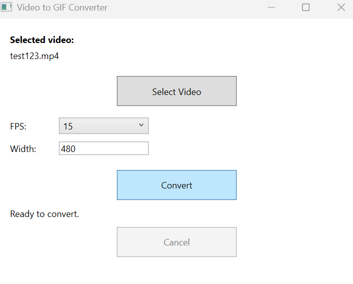

# VideoToGifConverter

A Windows desktop application for converting videos into animated GIFs using **C#, .NET 10, WPF and FFmpeg**.



## Features

- Convert video files into animated GIFs
- Adjustable frame rate (10–30 FPS)
- Adjustable output width with automatic aspect ratio preservation
- Palette optimization using FFmpeg's `palettegen` and `paletteuse` filters
- Real-time conversion progress bar with percentage display
- Cancel conversions while they are running
- Automatically delete incomplete GIFs after cancellation
- Asynchronous conversion to keep the UI responsive
- Input validation and descriptive error messages
- Conversion status messages (ready, converting, completed, failed, cancelled)
- Windows file dialogs for selecting input videos and output locations
- Default settings of 15 FPS and 480 pixels wide

## Project Structure

### VideoToGifConverter.Core

Contains the application logic, including:

- Video-to-GIF conversion
- FFmpeg process management
- FFprobe video duration detection
- Progress calculation
- Cancellation handling
- Input validation
- Shared models and interfaces

### VideoToGifConverter.Desktop

The WPF desktop application, responsible for:

- User interface
- Video selection
- Conversion settings
- Progress display
- User interaction and status messages

### VideoToGifConverter.Tests

Contains automated unit tests for conversion logic, validation, progress reporting, FFmpeg arguments and cancellation behavior.

**Current test suite: 25 tests.**

## Technologies

- C#
- .NET 10
- WPF
- FFmpeg and FFprobe
- xUnit (unit testing)

## Getting Started

### Requirements

- Windows
- .NET 10 SDK (for building from source)
- FFmpeg and FFprobe executables

### Running the Application

1. Clone or download this repository.
2. Open the solution in Visual Studio with .NET desktop development support.
3. Obtain the Windows FFmpeg executables.
4. Place `ffmpeg.exe` and `ffprobe.exe` inside a folder named `ffmpeg` in the application's output directory, alongside the compiled application.
5. Build and run `VideoToGifConverter.Desktop`.

The application looks for FFmpeg in:

`<Application Output Directory>/ffmpeg/ffmpeg.exe`

And FFprobe in:

`<Application Output Directory>/ffmpeg/ffprobe.exe`

### Using the Converter

1. Click **Select Video** and choose a video file.
2. Select your desired FPS.
3. Enter the GIF output width.
4. Click **Convert** and choose where to save the GIF.
5. Monitor the conversion progress or click **Cancel** to stop the operation.

**Note:** High resolutions and frame rates can produce very large GIF files. The default settings of 15 FPS and 480 pixels provide a more practical starting point for typical conversions.

## Running Tests

Run the automated tests from the solution directory:

```bash
dotnet test
```

The tests use fake implementations of external dependencies, allowing the conversion logic to be tested without launching FFmpeg.

## Release History

### v1.0 — Initial Release

The first functional version of the desktop converter, including video selection, adjustable settings, basic validation and GIF generation.

### v1.1.0 — Ready for Release

Version 1.1 introduces improvements to GIF quality, conversion reliability, and the user interface.

**New features and improvements:**

- Real-time conversion progress with percentage display
- Conversion cancellation support
- Automatic cleanup of incomplete GIF files
- Expanded input validation and error handling
- GIF palette optimization using FFmpeg's `palettegen` and `paletteuse` filters
- Improved WPF layout and control alignment
- More practical default settings (15 FPS, 480 pixels)
- Conversion status messages
- Improved filename display
- Expanded automated test coverage

**Verification:**

- 25 automated unit tests passing
- Release build successful
- Manual GIF conversion and cancellation tested
- Release executable tested outside Visual Studio

## Planned Improvements

Potential future features include:

- Video preview before conversion
- Video trimming and custom start/end times
- Custom output height
- Drag-and-drop video selection
- GIF conversion quality presets
- Batch conversion
- Application installer and distribution

## FFmpeg

This application uses FFmpeg for video processing and FFprobe for retrieving video information.

The source repository does not include the FFmpeg executables. The application has been developed and tested with the Gyan.dev Windows essentials build of FFmpeg 8.1.2.

See [THIRD-PARTY-NOTICES.md](THIRD-PARTY-NOTICES.md) for FFmpeg build and licensing information.

FFmpeg is developed by its respective contributors and is subject to its own licensing terms.